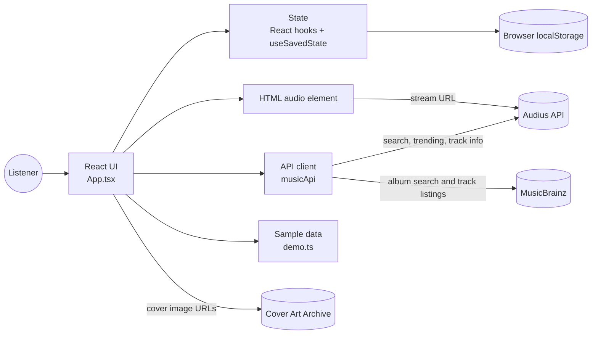
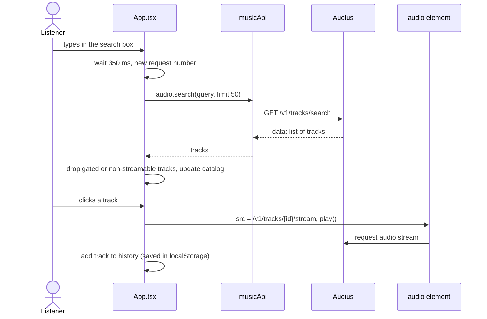
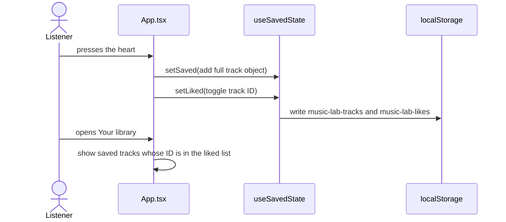

# Architecture

## 1. Overview

Music Lab is a single-page application that runs entirely in the browser. There is no server of our own: the app talks directly to public music APIs and stores the user's data in the browser's `localStorage`. The result can be hosted as plain static files.

Main technologies:

| Concern | Choice |
| --- | --- |
| UI | React 19 (function components and hooks) |
| Language | TypeScript with `strict` mode |
| Build tool | Vite 8 |
| Audio playback | The browser's built-in `<audio>` element |
| Persistence | `localStorage` through a custom hook |
| Tests | Node test runner for API/storage, Playwright for desktop/mobile UI |

## 2. System context

All three providers are connected to the running application. MusicBrainz metadata is kept separate from Audius audio identifiers.

## 3. Layers and components

| Layer | Files | Responsibility |
| --- | --- | --- |
| Presentation | `index.html`, `src/main.tsx`, `src/App.tsx`, `src/styles.css` | Screens, controls, layout, accessibility |
| Application state | hooks in `App.tsx`, `src/useSavedState.ts` | Current view, current track, queue, likes, playlists, history |
| Service | `src/api/music.ts` | Calls to external APIs, input validation, timeouts, rate limiting |
| Sample data | `src/data/demo.ts` | Fictional artists, albums and tracks used as a fallback |
| External services | Audius, MusicBrainz, Cover Art Archive | Music metadata, audio and images |

### 3.1 User interface (`App.tsx`)

`App` coordinates the interface and delegates catalog browsing, song information, and media artwork to `Catalog`, `SongDetails`, and `Artwork`. It renders:

- a sidebar with navigation (Discover, Search, Your library) and a liked-songs shortcut
- a top bar with the search box
- a content area with filter chips (All, Songs, Albums, Artists), the track list, album and artist grids, playlists, the queue panel and recently played
- a fixed player bar at the bottom with the track name, like button, previous/play/next, seek bar, shuffle, repeat, queue button and volume

Key functions:

| Function | What it does |
| --- | --- |
| `navigate(view)` | Switches view and resets search text, filter, and selected album, artist and playlist |
| `selectTrack(id)` | Finds the track in all known lists, sets it as current, starts playback and records it in history (at most 50 entries, no duplicates). Sample tracks (IDs starting with `demoAudio`) have no audio, so only a message is shown |
| `skip(direction, ended)` | Chooses the next track. Order of priority: repeat-one restarts the track, then the queue, then the playback list captured when a song was selected (random choice if shuffle is on). With repeat off, playback stops at the end of the list |
| `toggleLike(id)` | Adds or removes the track ID in the liked list and stores the full track object so it can be shown in the library later |
| `addToPlaylist(name, track)` | Adds a track to a playlist unless it is already there |

### 3.2 State and persistence (`useSavedState.ts`)

`useSavedState` works like `useState` but reads its initial value from `localStorage` and writes every change back. If storage is unavailable or full, or if the stored data has an unexpected shape, the hook uses the fallback value and the app keeps working in memory. Four keys are used; they are described in [data-model.md](data-model.md).

All other state (current view, queue, volume, playback position) is plain React state and is lost when the page is reloaded.

### 3.3 API client (`api/music.ts`)

`createMusicApi()` returns an object with these groups of methods:

| Group | Provider | Methods |
| --- | --- | --- |
| `songs` | MusicBrainz | `search`, `get` |
| `artists` | MusicBrainz | `search`, `get`, `albums` |
| `albums` | MusicBrainz | `search`, `get` |
| `artwork` | Cover Art Archive | `frontUrl` |
| `audio` | Audius | `search`, `trending`, `get`, `streamUrl` |
| `users` | Audius | `search`, `get`, `tracks` |

The module exports one shared instance, `musicApi`. The app uses `audio` and `users` for playable songs/profiles, `albums` for catalog releases/track listings, and `artwork` for cover URLs.

Design points of the client:

- **Input validation before any request.** MusicBrainz IDs must be UUIDs, Audius IDs must be alphanumeric, search text cannot be empty, `limit` must be 1 to 100 and `offset` must not be negative. Invalid input throws immediately and no request is sent.
- **Safe search queries.** MusicBrainz search text is wrapped in quotes and backslashes and quotes inside it are escaped, so users cannot inject search operators.
- **Rate limiting.** MusicBrainz asks for at most one request per second. Calls are placed in a queue and started at least 1.1 seconds apart, even after a failed request.
- **Timeouts and errors.** Each request is aborted after 10 seconds. A non-success HTTP status raises `MusicApiError` with the status code.
- **Injectable `fetch`.** The factory accepts a replacement `fetch`, which allows the tests to run without a network.

## 4. Main runtime flows

### 4.1 Search and play

Details:

1. A short delay (debounce of 350 ms) avoids one request per keystroke.
2. Every request gets a number. When an answer arrives, it is used only if its number is still the latest one. This prevents a slow, old answer from replacing newer results.
3. An empty search box loads trending tracks instead of search results.
4. If the request fails, the app shows the sample catalog and tells the user that live music is unavailable.

### 4.2 Like a track and save it

The full track object is stored, not only the ID, because the library must be able to show title and artist later without calling the API again.

## 5. Design decisions

| Decision | Reason | Trade-off |
| --- | --- | --- |
| No backend | Simpler to build, run and host. Audius and MusicBrainz need no secret key for reading | Nothing is shared between devices. A secret key could not be used safely in browser code |
| Audius for audio | MusicBrainz has metadata only and cannot stream songs | Not every Audius track can be played; gated tracks are filtered out |
| Separate ID types | MusicBrainz UUIDs and Audius IDs are different namespaces and cannot be matched automatically | The two catalogs cannot be merged into one list |
| `localStorage` for saved data | Works without accounts and without a server | Data stays on one browser and can be cleared by the user |
| Plain React state, no state library or router | The app is small; fewer dependencies | All screens share one large component and views have no own URL |
| API client as a factory with injectable `fetch` | Makes the client testable without the network | Slightly more code than calling `fetch` directly |

## 6. Security and privacy

- No API secrets are used. A public Audius API key, app name, and base URL can optionally be configured in `.env.local`. The API documentation advises against putting secrets in `VITE_` variables because Vite includes them in the public bundle.
- All user input that becomes part of a URL or query is validated or escaped.
- React escapes text it renders, which protects against script injection through track titles.
- The app stores no personal data on a server. Liked songs, playlists and history stay in the user's browser.
- Third-party requests go to Audius, MusicBrainz, Cover Art Archive, and provider image/media hosts. Their terms and attribution requirements apply.

## 7. Accessibility

The interface has a "Skip to music" link, labelled controls (for example Previous track, Next track, Seek, Shuffle), `aria-pressed` on toggle buttons, `aria-current` on the active navigation item, and a status line with `role="status"` that announces loading, empty and error states.

## 8. Known limitations

- Album metadata does not imply an available audio match; “Find audio” searches Audius separately.
- There are no user accounts. Data is per browser.
- Rate limiting is per browser tab. It does not coordinate several tabs or several users behind one network address.
- Failed requests are not retried automatically.
- Automated tests use deterministic providers; external availability and deployed CORS still need a live smoke test.
- The app depends on third-party services being online and allowing browser requests.

## 9. Possible future work

- Split `App.tsx` into smaller components (player bar, track list, sidebar, library).
- Add routing so each view has its own address.
- Add user accounts and server-side storage for playlists.
- Add a small proxy server that shares rate limiting and caching for all users.
