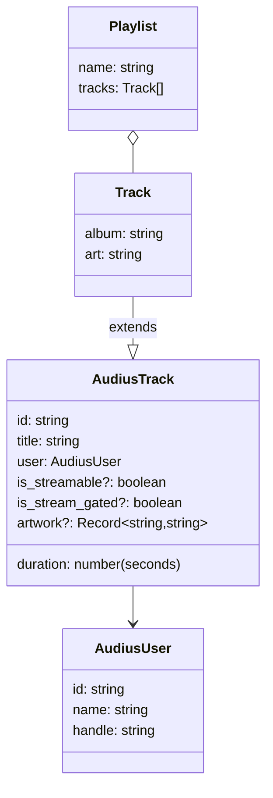

# Data model

The app has no database. Data comes from two places: responses from external APIs (held in memory as TypeScript objects) and the user's saved collections (stored in the browser's `localStorage`).

## 1. Core types

Defined in `src/api/music.ts`.



`Track` is defined in `App.tsx` as `AudiusTrack & { album: string; art: string }`. Tracks from Audius get `album = "Audius"` and `art = "blue"`. Sample tracks carry their own album name and color.

MusicBrainz types (used by the API client, not yet by the interface):

| Type | Fields |
| --- | --- |
| `Artist` | `id`, `name`, optional `country`, `disambiguation` |
| `Credit` | `name`, optional `joinphrase`, `artist` |
| `Song` | `id`, `title`, optional `length` (milliseconds), optional `artist-credit` |
| `Album` | `id`, `title`, optional `date`, optional `artist-credit` |
| `Page<T>` | `items`, `total`, `offset` |

Units differ between providers: MusicBrainz `length` is in milliseconds, Audius `duration` is in seconds. IDs also differ: MusicBrainz uses UUIDs, Audius uses short alphanumeric strings. They must never be mixed.

## 2. Browser storage

`useSavedState` stores each value as JSON under a fixed key.

| Key | Content | Limits and rules |
| --- | --- | --- |
| `music-lab-likes` | Array of track IDs (`string[]`) | Toggled by the heart button |
| `music-lab-tracks` | Array of full `Track` objects | A track is added when first liked and is not removed on unlike. The library shows only tracks whose ID is in the likes list |
| `music-lab-playlists` | Array of `{ name, tracks }` | Names are unique and at most 80 characters. A track appears only once per playlist |
| `music-lab-history` | Array of `Track`, most recent first | At most 50 entries; playing a track again moves it to the front |

Example of stored data:

```json
{
  "music-lab-likes": ["abc12"],
  "music-lab-tracks": [
    { "id": "abc12", "title": "Demo", "duration": 180,
      "user": { "id": "u1", "name": "Artist", "handle": "artist" },
      "album": "Audius", "art": "blue" }
  ],
  "music-lab-playlists": [{ "name": "Study", "tracks": [] }],
  "music-lab-history": []
}
```

### Loading and failure behavior

When the page loads, each key is read and checked. The value is accepted only if it is an array and every item is either a string or an object that has an `id`, or a `name` together with a `tracks` array. Otherwise the default (an empty list) is used. If reading or writing fails, for example because storage is blocked or full, the app continues with in-memory state.

## 3. Data that is not stored

Current view, search text, filter, queue, shuffle and repeat settings, volume, and playback position exist only in memory and reset on reload.

## 4. Sample data

`src/data/demo.ts` contains 4 artists, 4 albums and 5 tracks with fictional names. Sample track IDs start with `demoAudio` and must never be sent to an API. They have no audio.
